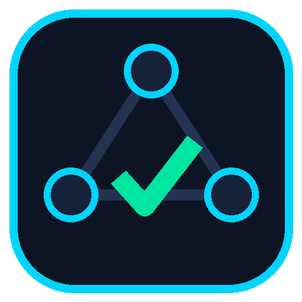

# NetOps Desk

A Windows desktop **To-Do list + Notes** app for IT & network work, written in Python.



## Download

Go to **Releases** and download one of:

| File | What it is |
|---|---|
| `NetOpsDesk-Setup-x.y.z.exe` | Installer: Start-menu entry, optional desktop shortcut, uninstaller. No admin rights needed. |
| `NetOpsDesk-Portable-x.y.z.exe` | Single file that runs without installing (e.g. from a USB stick). |

The app is not code-signed, so Windows SmartScreen may warn on first run: **More info → Run anyway**.

## The two connected parts

**☑ To-Do List**
- Quick-add bar (type and press Enter) with category, priority and due date
- Categories made for IT work: Network, Server, Security, Helpdesk, Hardware, Cloud, Study, General
- Priorities Critical / High / Medium / Low shown as a color strip
- Status flow Open → In Progress → Done, with one-click Start / Finish / Reopen
- Overdue / due-today highlighting, filters, live search

**✎ Notes**
- Autosaves while you type, monospace editor for configs and commands
- Templates: Incident Report, Device Config, OSI Troubleshooting checklist, Change Request, Meeting, Study/Lab notes
- Tags, pinning, categories, export to `.txt` / `.md`
- Toolbar: timestamp, checklist item, code block, divider

**How they are related:** any task can have linked notes and any note can have linked tasks
(many-to-many). From a task press **+ New linked note**; from a note use **Link a task…** or
**+ Task from note**. Cards show how many links they have and open each other in one click.

**Extras:** a dashboard (open / in-progress / overdue / done-today counters, completion bar,
priority queue, pinned notes, live clock) and a **Subnet Calculator** that can save a full IP plan
straight into a note.

### Keyboard shortcuts
`Ctrl+N` new task · `Ctrl+Shift+N` new note · `Ctrl+F` search · `Ctrl+1..4` switch page · `Ctrl+S` save in the task editor · `Esc` close dialog

## Design and storage choices

- **Theme – "NOC dark":** modeled on a network operations center wall: deep navy background,
  neon cyan accent, status colors (green = done/up, amber = in progress/warning,
  red = critical/overdue), monospace for IPs and configs, large readable fonts.
- **Storage – SQLite:** built into Python, a single file, no server, and supports the real
  task↔note relationship with foreign keys. The database is at
  `%APPDATA%\NetOpsDesk\netops.db` and is kept when you uninstall.
  Use **Backup database** in the sidebar to copy it anywhere.

## Run from source

```bash
pip install -r requirements.txt
python run.py
```

Tests: `pip install pytest && python -m pytest`

## How the .exe is built

`.github/workflows/build-windows.yml` runs on a Windows machine on every push: it runs the tests,
builds the app with **PyInstaller**, launches the built exe in `--selftest` mode, packages it with
**Inno Setup** (`installer/netops_desk.iss`) and publishes the files to a GitHub Release.
To build locally on Windows:

```bat
pip install -r requirements.txt pyinstaller
pyinstaller --noconfirm --windowed --name NetOpsDesk --icon assets/icon.ico --add-data "assets;assets" --collect-data customtkinter run.py
iscc installer\netops_desk.iss
```
